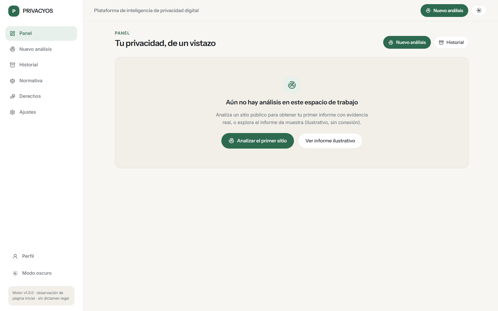

# PRIVACYOS

**Convierte señales técnicas de privacidad web en prioridades claras de revisión.**

PRIVACYOS analiza sitios públicos y organiza los hallazgos en un informe con evidencias, un puntaje orientativo y acciones recomendadas.

[Visitar la aplicación](https://privacyos-v2.vercel.app/) · [Ver la presentación](docs/HITO_1/presentacion/PRIVACYOS_Presentacion.pdf)

## Funcionalidades

- Escaneo de sitios públicos e informes con hallazgos, evidencias y puntuación.
- Gestión de sitios, historial y comparación de análisis por espacio del navegador.
- Asistente Gemini para consultar un informe y hacer preguntas de seguimiento. Requiere configuración del servidor.

La persistencia, el aislamiento y Gemini se verificaron en un entorno de pruebas.

## Tecnología e instalación

Next.js y React sirven la interfaz y la API. TypeScript y Zod validan los datos, Prisma conecta con PostgreSQL y Gemini responde a las consultas del asistente.

Con Node.js 20 o posterior y PostgreSQL local de pruebas, copia [.env.example](.env.example) a .env y configura DATABASE_URL y DIRECT_URL.

    npm ci
    npx prisma generate
    npx prisma migrate deploy
    npm run dev

Abre [http://localhost:3000](http://localhost:3000).

## Documentación

- [Hito 1 · Propuesta y prototipo](docs/HITO_1/README.md)
- [Hito 2 · Servicio, API y datos](docs/HITO_2/README.md)
- [Hito 3 · Producto y entrega final](docs/HITO_3/README.md)
- [Manuales de uso e instalación](docs/MANUALES/README.md)
- [Arquitectura](docs/ARQUITECTURA/README.md) · [Seguridad](docs/SEGURIDAD/README.md) · [Despliegue](docs/DESPLIEGUE/README.md)
