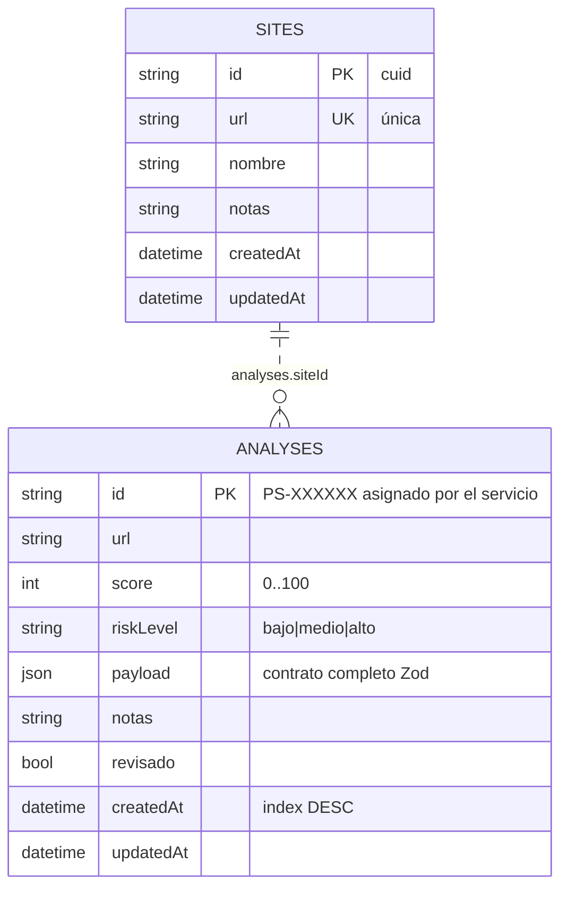

# PRIVACYOS · Base de datos (Hito 2)

Motor: **PostgreSQL** (Supabase en producción, o cualquier Postgres accesible).
ORM: **Prisma 6** (esquema fuente en `../prisma/schema.prisma`).

## Creación desde cero (reproducible)

Debes tener una URL válida en la variable `DATABASE_URL` (ver `.env.example` en la raíz).

### Opción A — script incluido (reproduce el esquema sin ORM)

```bash
psql "$DATABASE_URL" -f db/init.sql
```

`init.sql` es **idempotente** ante esquema vacío y lo genera `prisma migrate diff`;
es el mismo SQL que aplican las migraciones de Prisma.

### Opción B — ORM (recomendada en desarrollo)

```bash
npm install                 # instala dependencias (incluye prisma)
npx prisma migrate dev      # crea las tablas desde prisma/schema.prisma
npx prisma generate         # genera el cliente tipo-seguro
```

Comprobación: `npx prisma studio` debe mostrar las tablas `sites` y `analyses`.

## Diagrama de datos (`erd.mmd`)



## Decisiones de integridad

- `analyses.siteId → sites.id` — `ON DELETE RESTRICT `: no se borra un sitio con
  análisis asociados; la API responde **409 Conflict** y se elimina primero el
  análisis. (Elección deliberada: preservar evidencias históricas.)
- `url` única en `sites` → la API responde **409 Conflict** al duplicar.
- `payload` JSONB guarda el análisis completo validado por Zod (hallazgos,
  evidencias, plan); score/riskLevel quedan denormalizados para listas rápidas.
