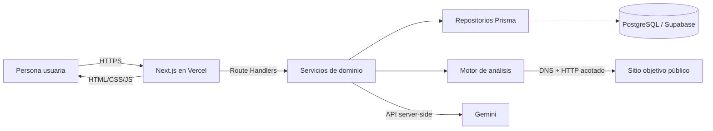
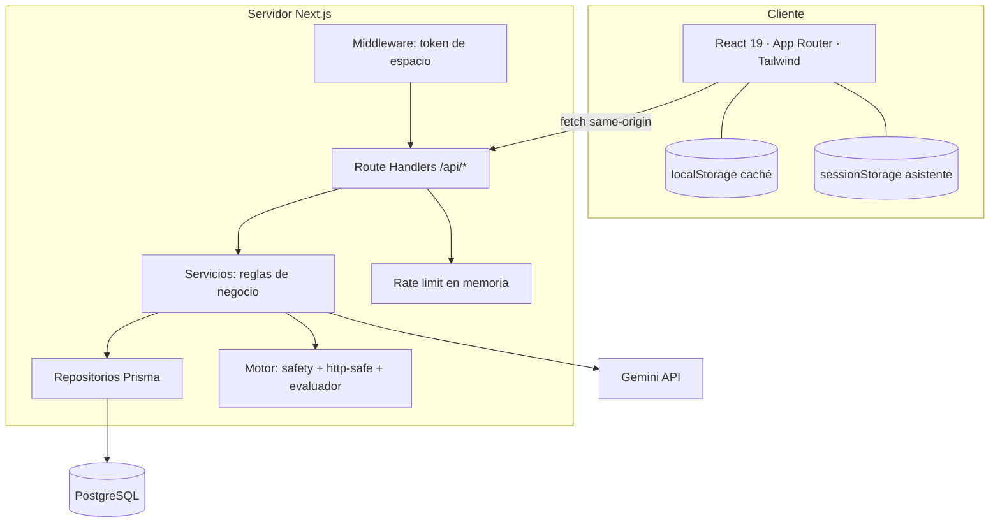
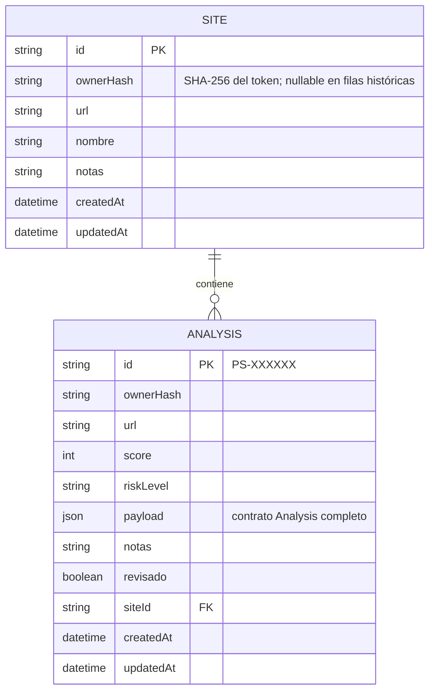
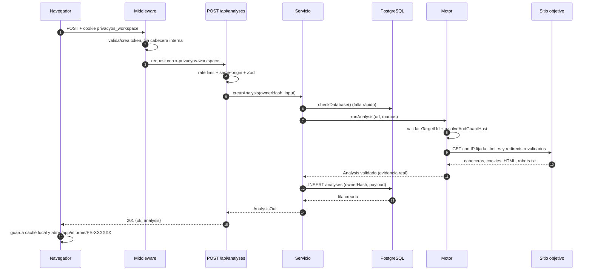
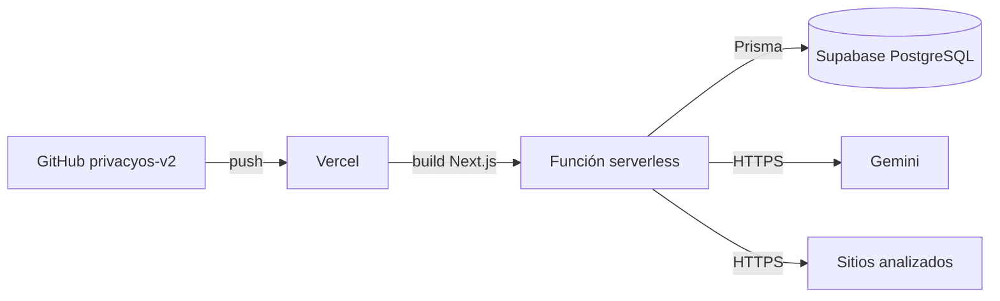

# Arquitectura de PRIVACYOS V2

## 1. Contexto

PRIVACYOS es una aplicación web que analiza señales técnicas observables de la página inicial de un sitio público y las traduce en hallazgos explicables, un score reproducible y un plan de acción. El sistema es un **monolito modular** desplegado en Vercel; no hay microservicios ni workers separados en esta fase.

### Actores y límites

| Actor | Confianza | Puede |
|---|---|---|
| Navegador | No confiable | Enviar URL, marcos, preguntas, ids; conservar cookie de espacio. |
| Vercel/Next.js | Confiable | Validar, ejecutar el motor, persistir, llamar a Gemini. |
| Sitio objetivo | No confiable | Devolver cabeceras/HTML/cookies arbitrarias; nunca ejecutar su JS. |
| PostgreSQL | Confiable | Guardar filas aisladas por `ownerHash`. |
| Gemini | Tercero | Recibir contexto truncado del informe; no recibe claves ni datos de otros espacios. |

## 2. Contenedores y capas

| Capa | Archivos | Responsabilidad |
|---|---|---|
| Presentación | `app/`, `components/` | Rutas, formularios, informes, accesibilidad, estados de error. |
| Adaptador cliente | `lib/api-client.ts` | Fetch con timeout, degradación a caché local, contratos de resumen. |
| Controladores | `app/api/**/route.ts` | HTTP, origen, rate limit, validación, códigos de estado. |
| Servicios | `lib/services/` | Reglas de negocio, ejecución del motor, mapeo de errores. |
| Repositorios | `lib/repositories/` | Único punto de acceso a Prisma; filtro obligatorio por `ownerHash`. |
| Motor | `lib/analyzer/` | Validación anti-SSRF, HTTP seguro, evidencias, score, hallazgos. |
| Infra transversal | `lib/db.ts`, `lib/http.ts`, `lib/request.ts`, `lib/rate-limit.ts`, `lib/owner.ts` | Conexión, errores, CSRF, límites, identidad de espacio. |
| Persistencia local | `lib/store.ts` | Caché de historial, preferencias y contexto del análisis en curso. |

## 3. Modelo de datos

- `@@unique([ownerHash, url])` evita duplicar el mismo sitio dentro de un espacio.
- `@@index([ownerHash, createdAt(sort: Desc)])` acelera el historial.
- `Analysis.siteId` es opcional (`onDelete: Restrict`): un análisis avulso no requiere sitio registrado.
- El payload JSON conserva el contrato completo (`lib/contracts.ts`) para que el informe sea reproducible aunque cambie el evaluador.
- `ownerHash` es nullable solo por compatibilidad histórica. Los repositorios filtran por igualdad exacta, por lo que `NULL` nunca coincide con un hash.

## 4. Flujo de análisis persistido

### Degradación controlada

Si la base no responde, `POST /api/analyses` devuelve **503** antes de ejecutar el motor (evita gastar trabajo y perder el resultado). La pantalla de progreso detecta 503/red y llama a `POST /api/analyze` (sin persistencia), guarda en localStorage y avisa: “La base de datos no responde: el resultado se guardará solo en este navegador”.

## 5. Seguridad de la identidad

No hay cuentas. El “espacio de trabajo” es una **capacidad**:

1. El middleware lee `privacyos_workspace`; si falta o no cumple `^[a-f0-9]{64}$`, genera 32 bytes aleatorios con `crypto.getRandomValues`.
2. La cookie es `HttpOnly`, `SameSite=Lax`, `Secure` en HTTPS, `Path=/`, un año.
3. El middleware **borra** cualquier cabecera `x-privacyos-workspace` enviada por el cliente y fija la resuelta.
4. El servidor deriva `sha256("privacyos-workspace:" + token)`; la base nunca ve el token.
5. Todas las consultas de `sites`, `analyses`, actualización, borrado y purga filtran por `ownerHash`.

**Limitación:** si se borra la cookie o se usa otro dispositivo, el espacio no se recupera. No hay autenticación, segundo factor ni recuperación. Se declara en la UI y en el informe.

## 6. Motor de análisis

| Fase | Implementación |
|---|---|
| Validación | `validateTargetUrl`: solo HTTP(S), sin credenciales, puertos 80/443, longitud ≤ 2048, hostname sin caracteres raros. |
| Blocklists | IPv4 privadas/reservadas, CGNAT, loopback, link-local, multicast; IPv6 `::/96`, IPv4-mapped, NAT64, 6to4, Teredo, ULA, link-local, documentación, multicast; sufijos `.local`, `.internal`, `.lan`, `.corp`, etc. |
| DNS | `dns.lookup(host, {all:true})`; si **cualquier** dirección es privada, se rechaza. |
| Conexión | `node:http/https` con `lookup` que devuelve la IP validada; SNI y Host preservados; anti-rebinding. |
| Redirecciones | Manuales, máximo 3, cada destino revalida URL, DNS e IP; se bloquea HTTPS→HTTP. |
| Límites | Deadline (8 s por defecto), cabeceras ≤ 32 KB, cuerpo ≤ 512 KB, descompresión ≤ 1 MB, timeout de socket. |
| Evidencia | Cada hallazgo referencia evidencias observadas (`EV-*`) con fuente y fecha; si la página falla, se declara y no se inventan señales. |
| Score | Media ponderada de dimensiones evaluadas; las no evaluadas se excluyen y se declaran. |

## 7. Decisiones de arquitectura (ADR resumidas)

| ADR | Decisión | Motivo | Consecuencia |
|---|---|---|---|
| ADR-01 | Monolito modular Next.js | Equipo pequeño, despliegue simple, rúbrica académica. | Escalar exige separar workers si el motor crece. |
| ADR-02 | Espacio anónimo por cookie, no cuentas | Evita auth ficticia y permite aislamiento real en el plazo. | Sin recuperación entre dispositivos; se declara. |
| ADR-03 | `ownerHash` en la base | No almacenar el token; filtrar en SQL. | Migración y filas históricas invisibles. |
| ADR-04 | Motor con `node:http/https` + IP fijada | `fetch` no permite pinning DNS ni control total de redirects. | Más código propio que hay que probar. |
| ADR-05 | Gemini solo server-side y opcional | Proteger la clave y evitar dependencia crítica. | Si falla, el informe sigue disponible. |
| ADR-06 | localStorage como caché, no fuente de verdad | Continuidad sin red y compatibilidad Hito 1. | Posibles divergencias; la UI avisa. |
| ADR-07 | Rate limit en memoria | Simplicidad y cero costo en esta fase. | No distribuido; documentado como brecha. |
| ADR-08 | CSP base con `unsafe-inline` | Next inyecta scripts inline; nonce exige refactor. | Endurecimiento futuro documentado. |

## 8. Despliegue

- Runtime Node.js para route handlers del motor.
- Variables en Vercel: `DATABASE_URL`, `GEMINI_API_KEY`, `ASSISTANT_ENABLED`, `ASSISTANT_MODEL`, `CONTACTO_EMAIL`, `NEXT_PUBLIC_SITE_URL`.
- `maxDuration = 30` en rutas de análisis; deadline interno de 8 s.
- Health check: `GET /api/health` devuelve 200 si la base responde y 503 si no.
- Migraciones: `prisma migrate deploy` (nunca `migrate dev` en producción).

## 9. Deuda técnica priorizada

1. Restaurar base de producción y aplicar migración (bloqueante comercial).
2. Rate limit distribuido (Redis/KV).
3. Cuentas reales y recuperación entre dispositivos (si el producto lo exige).
4. CSP con nonce + `strict-dynamic`.
5. Playwright + axe en CI y pruebas E2E de los flujos críticos.
6. Workers/colas si se agrega crawling o análisis programado.
7. Observabilidad: trazas, métricas de latencia del motor y alertas de health check.
