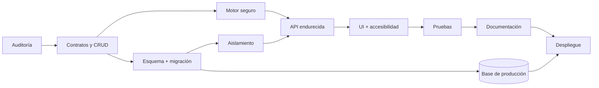

# Análisis del Gantt y desviaciones

## 1. Lectura honesta

No hay historial de commits ni planificación oficial con fechas en el repositorio, por lo que **no se reconstruyen fechas exactas**. Este análisis usa semanas relativas (S1–S8) y se basa en el trabajo realmente observado: auditoría, correcciones, pruebas y documentación. El Gantt existente (`docs/hito2-gantt.md`, `docs/carta-gantt.html`) se conserva como planificación visual del Hito 2.

## 2. Planificación de referencia

| Semana | Entregable | Dependencias | Estado |
|---|---|---|---|
| S1 | Auditoría forense, baseline, diagnóstico de DB | Acceso al repo y producción | Completado |
| S2 | Contratos, capas, CRUD, esquema Prisma | S1 | Completado |
| S3 | Motor seguro: SSRF, DNS, redirects, límites | S2 | Completado |
| S4 | Aislamiento por espacio, migración, repositorios | S2 | Completado |
| S5 | API endurecida, rate limit, health, errores | S3, S4 | Completado |
| S6 | Accesibilidad, UI, asistente, textos | S4 | Completado |
| S7 | Pruebas unitarias, runtime, build, CI | S3–S6 | Completado |
| S8 | Documentación, modelo financiero, video, defensa | Todo | En curso |
| S9 | Restauración DB, migración, despliegue, E2E | Autorización | **Bloqueado** |

## 3. Camino crítico

**Ruta crítica real:** auditoría → contratos → esquema/migración → aislamiento → API → pruebas → despliegue. La base de producción es el eslabón que bloquea el cierre: sin ella, el CRUD queda probado solo en local y la demo pública no puede mostrar persistencia.

## 4. Desviaciones principales

| Desviación | Causa | Impacto | Acción |
|---|---|---|---|
| Persistencia no verificable en producción | Supabase pausado/eliminado (`ENOTFOUND`). | Alto: bloquea demo de CRUD. | Restaurar o proveer nueva `DATABASE_URL` (autorización). |
| Motor reescrito con `node:http/https` | `fetch` no permite pinning DNS ni control total de redirects. | +Complejidad, +seguridad. | Pruebas unitarias y runtime. |
| Aislamiento por cookie en vez de cuentas | Plazo y riesgo de auth ficticia. | Sin recuperación entre equipos. | Declarado; cuentas en fase posterior. |
| Rate limit en memoria | Evitar dependencia externa/costo. | No distribuido. | Redis/KV antes de escala. |
| Sin E2E/axe | Tiempo y peso de navegadores en CI. | Cobertura de UI parcial. | Añadir Playwright + axe. |
| Fuentes autoalojadas | Privacidad y CSP. | +2 archivos (~1 MB). | `next/font/local`, `display: swap`. |
| Migración no aplicada | Requiere autorización y backup. | Datos históricos invisibles hasta decidir. | Documentado; no se ejecutó. |

## 5. Lecciones

1. **La infraestructura es parte del producto:** un motor perfecto no sirve si la base no existe. El health check y la degradación evitan una caída silenciosa, pero no reemplazan la DB.
2. **La seguridad no es un checklist:** el pinning DNS y la revalidación de redirects cambiaron la arquitectura del motor; se debían probar con payloads reales.
3. **La accesibilidad se diseña, no se parchea:** tabs, modal, foco y estados live requieren componentes base correctos.
4. **El copy es parte de la honestidad:** los textos de “no hay servidores” del Hito 1 habrían sido falsos tras la persistencia; se corrigieron.
5. **Documentar la deuda es mejor que ocultarla:** rate limit, CSP y cuentas quedan declarados con plan.

## 6. Próximas dos semanas (propuesta)

| Día | Tarea | Responsable | Criterio de done |
|---|---|---|---|
| D1 | Autorización + backup + restaurar Supabase | Usuario/Dev | `/api/health` 200 |
| D2 | `prisma migrate deploy` + verificación de esquema | Dev | Columnas/índices presentes |
| D3 | CRUD con dos cookies + script | Dev | Aislamiento demostrado |
| D4 | Playwright E2E + axe | Dev | 5 flujos y 0 violaciones críticas |
| D5 | Rate limit Redis/KV (si se decide) | Dev | Límite compartido |
| D6 | Despliegue y smoke test | Dev | URL pública con CRUD |
| D7 | Ensayo de video y defensa | Equipo | Guion cronometrado |
| D8–D10 | Colchón para incidentes | Equipo | — |

## 7. Conclusión

El proyecto está en condiciones técnicas para cerrar el Hito 2, con una deuda operativa concentrada en la base de producción y una deuda de pruebas concentrada en E2E/axe. El Gantt no falló por estimación: falló por una dependencia externa (Supabase) que se debe resolver antes de la entrega.
