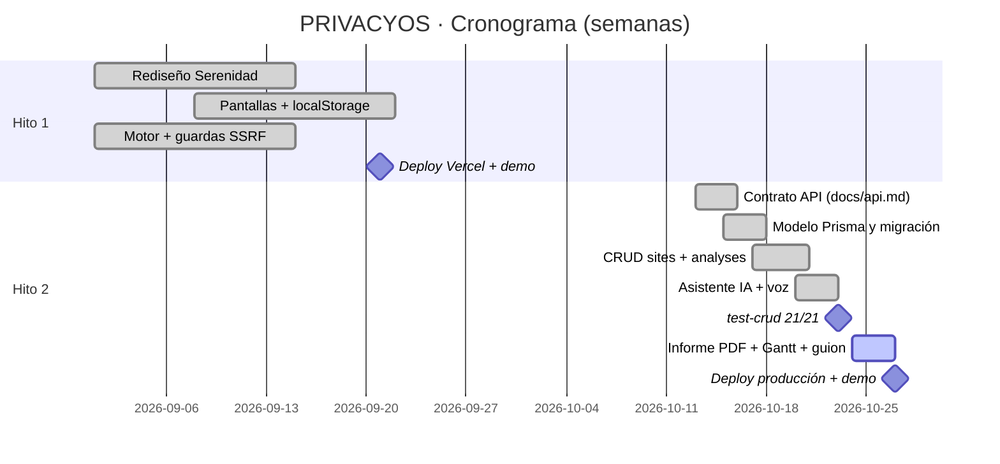

# PRIVACYOS · Planificación Hito 2 (Gantt)

Curso: INGT1003 — Evaluación de Transición · Inicio Hito 1: SEP-2026 · Hito 2: OCT-2026

Tablero de semanas (semana 1 a semana 6); las celdas indican trabajo activo ▓ y cierre ✔.

| Bimestre | Catalina Romero (frontend) | Melisa Ibáñez (documentación y datos) | Simón Salgado (arquitectura y backend) |
|---|---|---|---|
| **S1** | ▓ Rediseño visual «Serenidad»: tokens, paleta, tipografía, modo oscuro | ▓ Investigación normativa (21.719, 19.628, GDPR) y catálogo de marcos | ▓ Motor de evidencia v1, guardas anti-SSRF, primera API `/api/analyze` |
| **S2** | ▓ Pantallas de análisis, historial y perfil (localStorage) | ▓ Primera versión del README, `.env.example`, plan de despliegue | ▓ Deploy en Vercel; pruebas de SSRF; integración Zod |
| **S3 — entrega Hito 1** | ✔ Ajustes finos y demo | ✔ Registro / bitácora | ✔ Demo en vivo |
| **S4** | ▓ Diccionario de API desde el front (historial, comparar) · diseño del flujo de borrado | ▓ `docs/api.md` (contrato completo) — escrito **antes** de programar el CRUD | ▓ Modelo Prisma, decisión FK RESTRICT, id `PS-XXXXXX`, migración baseline |
| **S5** | ▓ Widget del asistente IA + dictado de voz · degradación elegante a localStorage | ▓ Colección Postman encadenada · `db/init.sql`, `db/erd.mmd`, guía BD · Gantt y guion | ▓ Servicios + repositorios + envolvente de errores; `scripts/test-crud.mjs` (21 checks) |
| **S6** | ▓ Pulido final del front (sin cambio de diseño) y triangulación con BD real | ▓ Informe técnico PDF, checklist DoD, referencias | ▓ Deploy en Vercel con `DATABASE_URL` + `ASSISTANT_ENABLED`; smoke test 21/21 en producción |
| **S6 — entrega Hito 2** | ✔ Demo en vivo (7 min) | ✔ Entrega de documentación | ✔ API viva en https://privacyos-v2.vercel.app |

## Contraparte entre recursos (hitos)

## Regla de entrega

- **Cada integrante es dueño de una dimensión** (front / docs / arquitectura), con pares de revisión en los pull internos.
- Un entregable **no cuenta como listo** hasta que su dueño marca ✔ y lo corrobora el segundo revisor.
